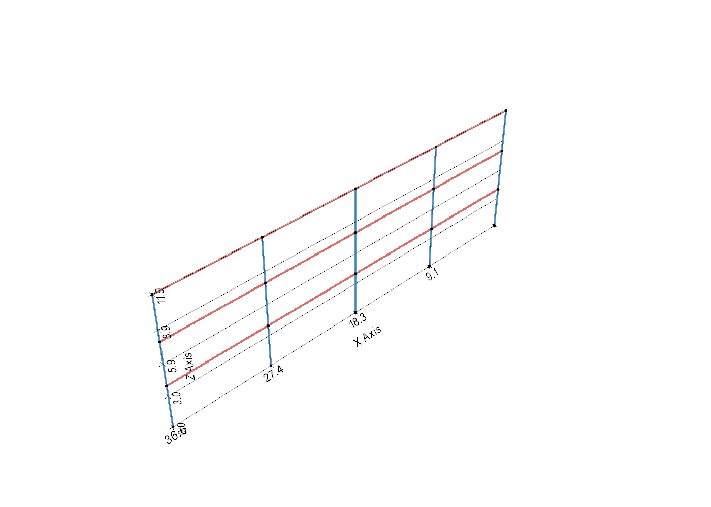
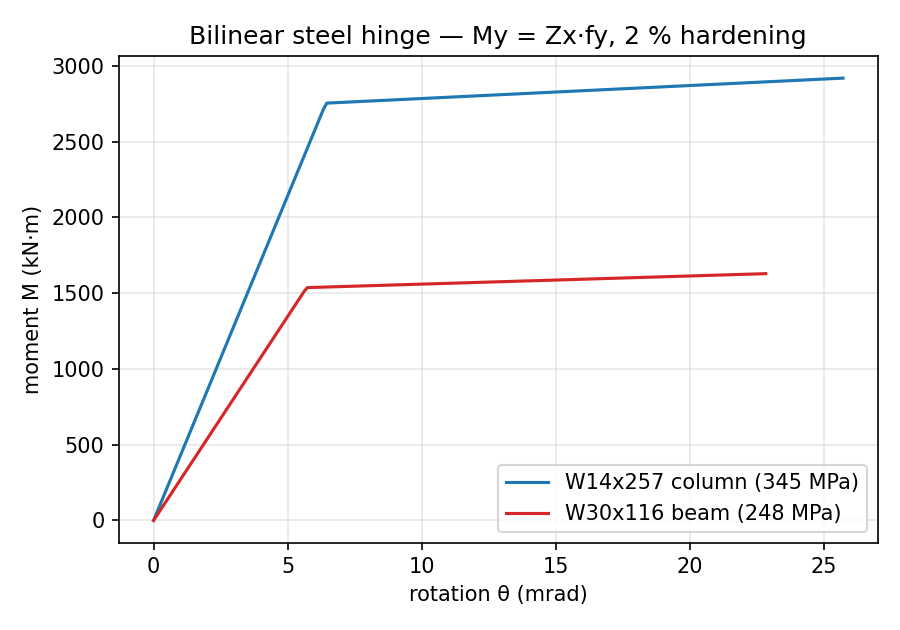
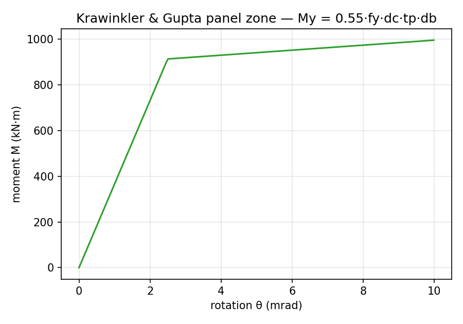
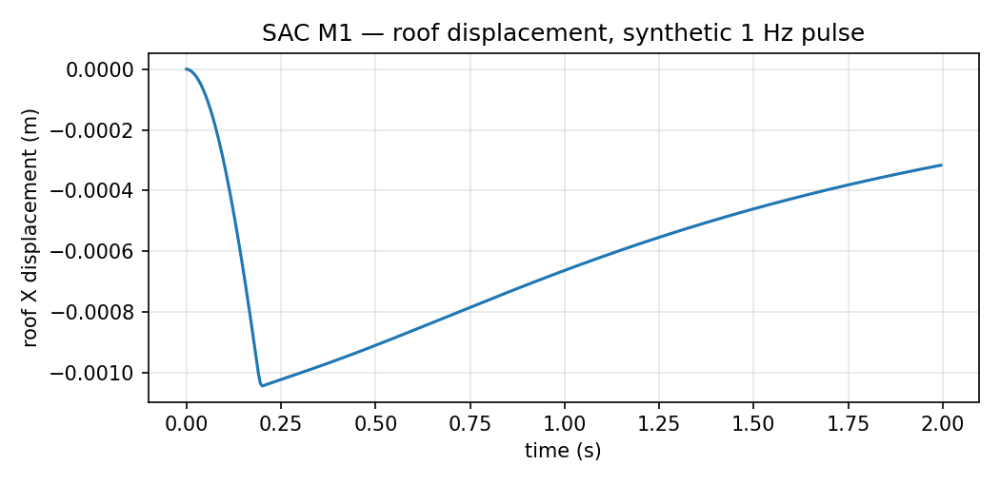
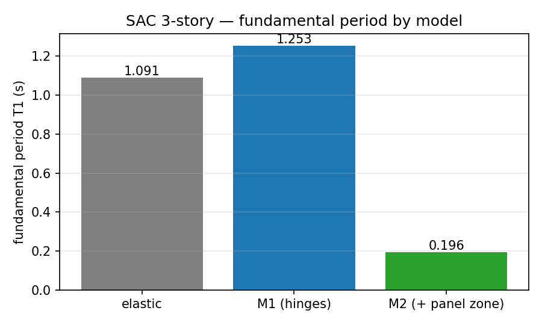

# SAC 3-Story Nonlinear Benchmark (T4)

## Purpose

The **T4** (published-FE-model) anchor for the nonlinear NLTHA path.  The same
three-story SAC steel moment frame used for the elastic modal anchor
([SAC 3-Story Frame Benchmark (T2)](sac_benchmark.md)) is built as a
**concentrated-plasticity** model — bilinear steel hinges at the member ends,
with an optional Krawinkler & Gupta panel zone at each beam-column joint — and
driven through the native Newmark transient runner against the published peak
roof displacement.

## Model

Geometry, members and masses follow the official benchmark model data
(`struct3.m`): 4 bays × 9.144 m, 3 stories × 3.9624 m, fixed bases; W14×257 /
W14×311 columns (plus a leaning column), per-level beams (W33×118 / W30×116 /
W24×68 with a W21×44 fourth bay); seismic mass L1 = L2 = 4.7835e5 kg,
L3 = 5.1779e5 kg, half per frame.  The model is built and enriched by
:mod:`fea_toolkit.benchmarks.sac` (single source of truth), which bundles the
Tcl transcription (`sac_3story.tcl`) and adds the plastic section moduli and
yield strengths.



### Evaluation-model variants

| Variant | Joint | Member nonlinearity |
|---|---|---|
| **M1** | centreline | bilinear steel hinges |
| **M2** | Krawinkler & Gupta panel zone | bilinear steel hinges |

The two variants share the same enriched `SAPModelData` but differ in the
**preprocessor config** (`panel_zone_model`): M2 is preprocessed into a
separate `MeshModel` whose beam-column joints are split, and the builder then
emits the panel-zone springs from the frozen `MeshModel.panel_zones` spec.

## Member nonlinearity — bilinear steel hinge (D1)

Each frame member is split into `node → hinge → elastic interior → hinge →
node`; the zero-length hinges use a `Steel01` backbone with yield moment
`My = Zx·fy` and a 2 % hardening ratio (`hinge_model='lumped'`,
`hinge_backbone='bilinear'`).

The plastic section moduli are from AISC tables (the benchmark's exact hinge
data are not redistributable):

| Member | Zx (in³ → m³) | fy (MPa) | My = Zx·fy |
|---|---|---|---|
| W14×257 column | 487 → 7.98e-3 | 345 | ≈ 2750 kN·m |
| W14×311 column | 603 → 9.88e-3 | 345 | ≈ 3410 kN·m |
| W33×118 beam | 415 → 6.80e-3 | 248 | ≈ 1690 kN·m |
| W30×116 beam | 378 → 6.194e-3 | 248 | ≈ 1540 kN·m |
| W24×68 beam | 177 → 2.90e-3 | 248 | ≈ 719 kN·m |
| W21×44 beam | 95.4 → 1.563e-3 | 248 | ≈ 388 kN·m |

The leaning column stays elastic (no plastic hinge).

### Hinge translation tie — `zeroLength -mat/-dir` (no `equalDOF`)

Each zero-length hinge is a `zeroLength` element carrying **all six DOFs** via
`-mat`/`-dir`: a rigid `Elastic` spring on the retained DOFs (P, Vy, Vz, T) and
the hinge material on the two rotational DOFs (dir 5 = strong-axis `Mz`, dir 6 =
weak-axis `My`, oriented by `-orient (vx, vz)`).  No `equalDOF` is used, so the
base node is only `fix`ed and `ops.nodeReaction` resolves correctly.  The base
shear is still recovered by **global equilibrium** `Σ m·(a_rel + ag)` — exact
for the base-excited, no-gravity benchmark — see `opensees/_runner_dynamic.py`.

*Historical note.*  An earlier revision modelled the hinge as a
`zeroLengthSection` Aggregator carrying only `[P, Mz, My, T]` (no shear) and
tied the hinge node's translations to the structural node with
`equalDOF(struct_node, hinge_node, 1, 2, 3)`.  That `equalDOF` is fragile under
the `Transformation` handler: at a fixed base the structural node is *both*
`fix`ed and the `equalDOF` master, `Transformation` "does not follow
constraints", and `ops.nodeReaction` reads back zero.  The `zeroLength -mat/-dir`
revision — the same "extra node + `zeroLength`" pattern used for frame releases
(`opensees/releases.py`, which states `equalDOF` is *deliberately not used*) —
fixed that and a cyclic-softening bug in the trilinear hinge (see
`benchmark_roadmap.md` §2 A4).

The 9-story gravity-bay pin remains skipped under `hinge_model='lumped'`: the
member-end release and the lumped hinge both re-point the member end, and the
lumped hinge wins (`opensees/_elements.py` `_create_member_releases`).  It is
left for the A3/A4 comparison.

`beamWithHinges` (below) needs no extra node or constraint at all — the hinge
lives in the element formulation.


### Approximation vs the benchmark trilinear backbone

The `Steel01` bilinear hinge is an **approximation**, not a bit-exact port.  The
benchmark's own member hysteresis is **trilinear**: `struct3.m`'s `mat_tbl`
carries three flexural rigidities `EI1 → EI2 → EI3` with two break curvatures
(`d1`, `d2`), evaluated by the authors' compiled S-function `Nonlin12.mexsol`
/ `Nonlin12.dll` (the "DO NOT MODIFY THIS" block in the archive `README.txt`).
That binary cannot be called from OpenSeesPy, so this model — like the
independent OpenSeesPy port in
[Johnsonlijian/eesd-1060116-reproducibility-20261003](https://github.com/Johnsonlijian/eesd-1060116-reproducibility-20261003)
— collapses the trilinear branch onto a bilinear `Steel01` backbone (initial
tangent `EI1`, 2 % hardening).  The *initial* stiffness — and hence the modal
frequencies — is preserved exactly; only the post-yield branch and any damage
accumulation differ from the MEX.

The yield moment carries a calibration gap too.  The benchmark's first break is
`My = EI1·d1`; this model uses `My = Zx·fy`.  The two agree closely for the
columns but drift apart for the deeper beams:

| Member | `Zx·fy` (this model) | `EI1·d1` (benchmark first break) | Δ |
|---|---|---|---|
| W14×257 column | ≈ 2750 kN·m | ≈ 2614 kN·m | +5 % |
| W14×311 column | ≈ 3410 kN·m | ≈ 3236 kN·m | +5 % |
| W33×118 beam | ≈ 1690 kN·m | ≈ 2191 kN·m | −23 % |
| W30×116 beam | ≈ 1540 kN·m | ≈ 1996 kN·m | −23 % |
| W24×68 beam | ≈ 719 kN·m | ≈ 935 kN·m | −23 % |
| W21×44 beam | ≈ 388 kN·m | ≈ 504 kN·m | −23 % |

A third spelling exists in the wild: the reference repo calibrates
`My = 8.0 · EI1 · min(d1, d2) / L` (a fitted factor, not derived from section
geometry) and reports a ~5–10 % median match to the published response.  None
of the three reproduces the MEX exactly; this model favours `Zx·fy` because it
is physical (AISC plastic modulus × yield strength) and needs no calibration
constant.

### Trilinear backbone — transcribed, and the member model identified

The exact trilinear backbone is now transcribed in
:mod:`fea_toolkit.benchmarks.sac_member_data` (`MAT_TBL_3/9/20` — `EI1/EI2/EI3`
+ `EA/GA` + break curvatures `d1/d2`, plus the `element_tbl` member→`Mat_no`
assignment), verified byte-for-byte against `struct3/9/20.m`.  Research into the
benchmark's member formulation (Ohtori et al. 2004 §Nonlinear Analysis Tool;
Clough & Johnston 1966; Giberson 1967; the IDARC2D verification) establishes that
the member is a **concentrated-plasticity one-component model** — elastic
interior plus end hinges — and that the benchmark publishes **neither a
plastic-hinge length (`Lp`) nor a yield-index (`α`) interpolation law**; both
live in the compiled S-function and are second-order (they shape the
elastic→plastic transition, not the backbone anchor points `My = EI1·d1` / `M2`).
The faithful mapping is therefore OpenSees `beamWithHinges` (elastic interior
`EI1` + trilinear M–κ end hinges).  A first pass is already implemented as a
**lumped-hinge** `Hysteretic` (`hinge_backbone="trilinear"` via
`enrich_trilinear`, 6EI/L κ→θ) — topology-consistent with the M1/M2 bilinear
hinge and correct at the backbone anchor points (`My = EI1·d1`, `M2`), with only
the elastic→plastic transition approximated (no `Lp`/α) and a "nearly rigid"
elastic spring that softens T1 ~5 %.

The preferred `beam_with_hinges` topology (also now implemented) replaces the
lumped spring with a `beamWithHinges` element: an elastic interior
(`E, A, Iz, Iy, G, J`) plus a trilinear moment-*curvature* `Uniaxial` section
(strong-axis `Mz`) at each end, with `Lp = L/6` (`hinge_length_fraction` — the
benchmark's θ = φ·L/6 member-end rotation).  No "nearly rigid" spring, so the
elastic stiffness is the exact `6EI1/L` (T1 0.993 s vs the elastic anchor
0.994 s), and the damage recorders read member-end *curvature* directly.  At the
benchmark's `dt_cal = 0.005 s` it is the closest match to the published
El Centro 1.0 peak (roof 0.149 m, drift 0.0148, base shear 12.03 MN as the
whole-building ×2, Nd 22 — targets 0.151 / 0.0150 / 10.12 / 22).  The residual
base-shear gap is a *monotonic transition* effect — the benchmark `Nonlin12`
S-function's unpublished yield-index α interpolation, which smooths the
elastic→plastic transition — not a hinge-length or damping effect (see
`sac_trilinear_hinge_approaches.md`).



## Joint modelling — Krawinkler & Gupta panel zone (D2)

`panel_zone_model='krawinkler_gupta'` (a **preprocessor** option) splits each
beam-column joint into a column node and a coincident beam node, coupled by a
zero-length bilinear shear-rotation spring with the K&G backbone:

```
My  = 0.55 · fy · dc · tp · db
Kθ  = 0.95 ·  G · tp · dc · db
```

where `dc` / `db` are the column / beam depths and `tp` the panel thickness
(column web thickness); post-yield hardening is 3 %.



Panel-zone softening is verified independently by the elastic-model period
shift (T1 0.99 → 1.13 s) and the subassemblage test
`test_analysis_csm.py::TestPanelZone`.

## NLTHA benchmark (T4)

Reference — Ohtori, Christenson, Spencer & Dyke (2004),
[*ASCE J. Eng. Mech.* 130(4):366](https://doi.org/10.1061/(ASCE)0733-9399(2004)130:4(366)),
Table 3: the 3-story nonlinear evaluation model reaches a peak roof
displacement of **~0.151 m** under the El Centro record at intensity 1.0.

The gated `@pytest.mark.needs_ground_motion("ELCENTRO")` test drives M1 and M2
under the El Centro record (from the benchmark archive, 2 % damping); **M1 lands
at ≈ 0.145 m** — within ~4 % of the reference.  A second gated
`@pytest.mark.needs_ground_motion("LA21")` test is a smoke check only — LA21 is
the 1995 Kobe (Takatori) record, not El Centro.



The always-on figure above uses a synthetic 1 Hz pulse (the real LA21 history
is generated only when the record mirror is populated).  The modal comparison
below shows how each modelling choice shifts the fundamental period.



## Panel zone + hinge composition

Combining the Krawinkler & Gupta panel zone with the bilinear hinge produces the
**M2** model: the panel-zone spring and the member-end hinge sit in series, and
**T1 ≈ 1.13 s** — correctly softer than both the elastic model (0.99 s) and M1
(1.04 s).  Regression-guarded by `test_sac3_m2_panel_zone_modal_period`.

*Historical note.*  An earlier revision degenerated (T1 ≈ 0.20 s, sway modes
locked) because the panel zone tied the beam's ``*_pz`` node to the column
(`equalDOF(col, beam, 1, 3)`) and the then-`equalDOF` hinge tied its hinge node
to that ``*_pz`` node — a **chained `equalDOF`** the `Transformation` handler
mis-resolved.  The `zeroLength -mat/-dir` hinge (no `equalDOF`) removed the
chain.

The panel-zone web thickness (`t_p` = column `tw`) carries a ~1/2 in (≈0.013 m)
add-on over the bare column web — e.g. the W14×257 panel zone uses 0.0435 m
rather than the 0.030 m web.  The Ohtori paper does not document doubler
plates, but the transcribed values are only consistent with a non-documented
1/2 in doubler (1/4 in per face), so they are kept as-is
(`sac.py` `_COLUMNS_BY_AREA`) rather than "corrected" to the bare web.

## Loadable artifact

The benchmark is a **loadable artifact**, not a private test helper:

- **Model** — :mod:`fea_toolkit.benchmarks.sac` exposes `load_model()`
  (enriched `SAPModelData`), `preprocess_config(panel_zone=…)`,
  `builder_config()` and `build_builder(panel_zone=…)`.
- **Committed model-codec snapshot** — `docs/assets/sac3_model.json` (written by
  `docs/_generate_sac_figures.py`), openable in the viewer:

  ```bash
  python examples/view_model.py docs/assets/sac3_model.json --result mesh
  ```

  > The model-codec snapshot reproduces the geometry, enriched sections
  > (`Z33`, `fy`) and thus the **M1** bilinear-hinge model.  It drops the
  > I-section dimensions (`depth`/`tw`), so the **M2** panel zone must be built
  > from the package builder rather than the JSON snapshot.

## Figures

`docs/_generate_sac_figures.py` regenerates the five figures and the JSON
artifact (each only when its file is absent), writing into `docs/assets/`.

## Research links

- Ohtori et al. (2004) — https://doi.org/10.1061/(ASCE)0733-9399(2004)130:4(366)
- Krawinkler (1978), "Shear in Beam-Column Joints in Seismic Design of Steel
  Frames", *AISC Engineering Journal* 15(3) — the panel-zone backbone.
- Krawinkler & Gupta (1998) — SAC steel-frame design / panel-zone modelling.
- AISC *Steel Construction Manual* — the `Zx` tables behind the derived yield
  moments (W24×68, W30×116).
- [Johnsonlijian/eesd-1060116-reproducibility-20261003](https://github.com/Johnsonlijian/eesd-1060116-reproducibility-20261003)
  — an independent OpenSeesPy port of the same `struct3.m` plant (EESD control
  paper), cross-checked against this model for the trilinear backbone and the
  yield-moment calibration.
- SAC ground motions (LA21) — see [Ground-Motion Data & Sources](ground_motion_data.md).

## Tests

- `tests/test_benchmark_sac3_nltha.py` — elastic + nonlinear NLTHA (synthetic
  pulse always-on, M1 + M2; LA21 gated), M1 band assertion, and
  `test_sac3_m2_panel_zone_modal_period` (M2 fundamental-period regression guard).
- `tests/test_analysis_csm.py::TestBuilderHingeModel` — bilinear hinge unit
  tests (config defaults, cantilever yield).
- `tests/test_analysis_csm.py::TestPanelZone` — panel-zone subassemblage.

